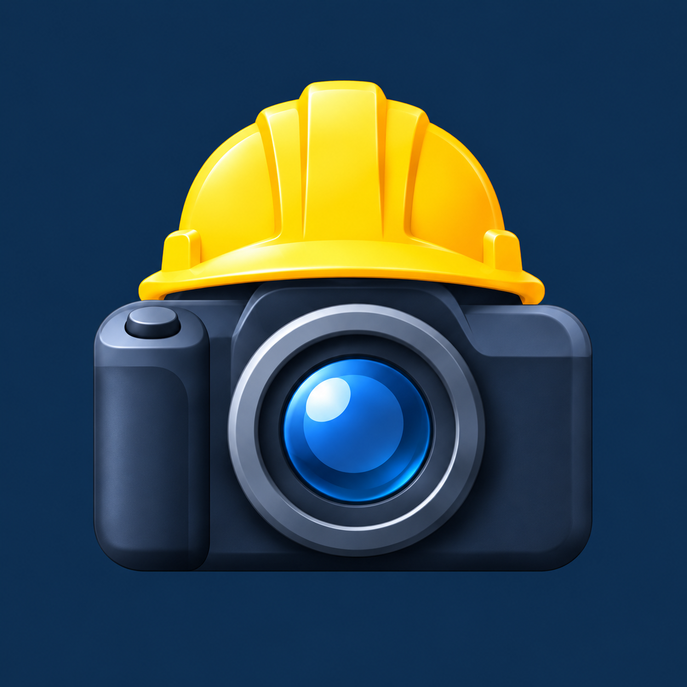
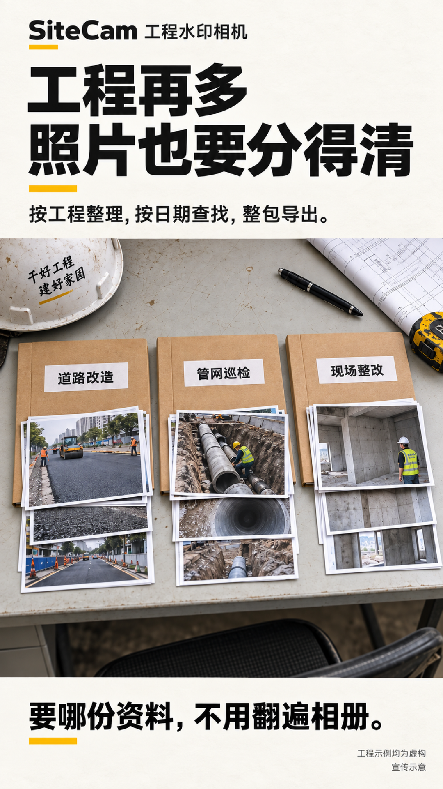
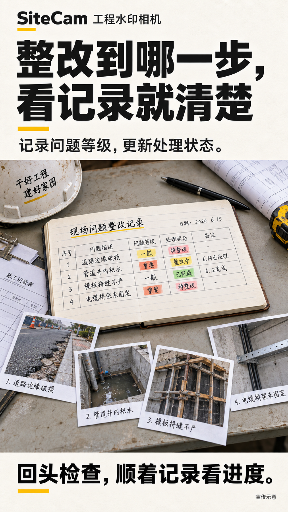
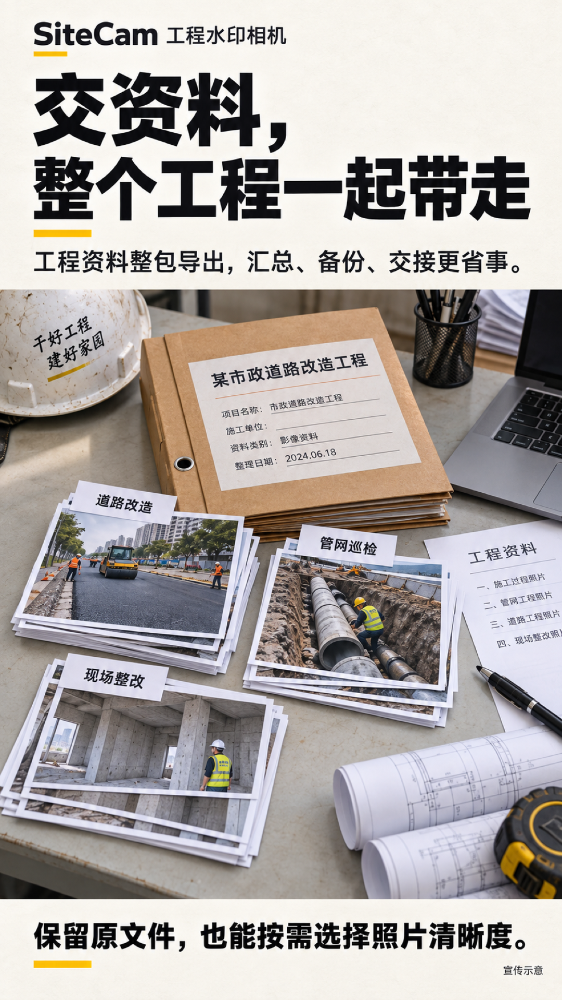

# SiteCam

**Engineering & Field Watermark Camera — Free · Open Source · Ad-Free**

  <a href="./README.md">简体中文</a> &nbsp;|&nbsp; <strong>English</strong>

  
  
  
  
  

  <a href="https://github.com/toydream525/SiteCam/releases/download/v0.4.7/SiteCam-0.4.7-Android-Release.apk"><strong>⬇️ Download Android APK</strong></a> &nbsp;·&nbsp;
  <a href="appmarket://details?id=com.sitecam.app">🌸 Huawei AppGallery (HarmonyOS)</a> &nbsp;·&nbsp;
  <a href="https://yuriaqua.com/sitecam/">🌐 Website</a> &nbsp;·&nbsp;
  <a href="./docs/USER_GUIDE.md">📖 User Guide (CN)</a> &nbsp;·&nbsp;
  <a href="https://github.com/toydream525/SiteCam/issues">💬 Issues</a>

---

## ✨ Feature Preview

Capture jobsite photos with structured watermarks, organize media by project, log field issues, and export deliverable packages in one tap. Current release: **v0.4.7**, with foldable/tablet layout support (beta) and a native HarmonyOS build.

<table>
  <tr>
    <td width="33%" align="center"></td>
    <td width="33%" align="center"></td>
    <td width="33%" align="center"></td>
  </tr>
  <tr>
    <td width="33%" align="center"></td>
    <td width="33%" align="center"></td>
    <td width="33%" align="center"></td>
  </tr>
</table>

---

## 🧰 Capabilities

| Workflow | How SiteCam Helps |
| :--- | :--- |
| **📷 Jobsite Watermark Capture** | Automatically stamps project name, timestamp, and location on photos & videos |
| **⚡ Rapid Capture & Burst** | Supports quick snapshot & burst shooting (snapshot mode enabled by default) |
| **🗂️ Project Organization** | Group media by project with search, categorization, archiving, and quick export |
| **📍 Manual Field Info** | Enter locations manually when offline; altitude watermark only displays valid readings |
| **🌦️ Weather & Quick Naming** | Fast project name input and editable weather watermark fields |
| **🔒 Safe Project Locking** | Lock or archive finished projects to prevent accidental capture or switching mid-shoot |
| **📱 Multi-Form-Factor UI** | Adaptive layouts for phones, foldables, wide screens, and tablets (beta) on Android & HarmonyOS |
| **📅 Filter & Batch Manage** | Filter by date, project, or issue status; batch move and share |
| **🚩 Issue Tracking** | Log field issues, set severity levels, and track progress through resolution |
| **✏️ Photo Markup** | Crop, rotate, draw arrows, mosaic, and add draggable re-editable text annotations |
| **🖼️ Watermark Existing Photos** | Import gallery photos, preview project watermarks, and save copies while preserving originals |
| **📦 Project Delivery Export** | Export ZIP archives or folders containing photos, videos, and manifests |

---

## 🚀 Get Started in 3 Steps

1. **Create a Project** — Enter the project name, route, and site location as needed.
2. **Capture & Annotate** — Choose your watermark template and log issues on the spot.
3. **Export Deliverables** — Export a ZIP archive or folder from the project or album and share directly.

---

## ⬇️ Downloads

| Platform | Status | Download |
| :--- | :--- | :--- |
| **🤖 Android** | **v0.4.7 Stable** (Android 8.0+) | [Release APK](https://github.com/toydream525/SiteCam/releases/download/v0.4.7/SiteCam-0.4.7-Android-Release.apk) |
| **🌸 HarmonyOS** | **v0.4.7 Native** | [Huawei AppGallery](appmarket://details?id=com.sitecam.app) · [Unsigned HAP](https://github.com/toydream525/SiteCam/releases/download/v0.4.7/SiteCam-0.4.7-HarmonyOS-Release-Unsigned.hap) · [Signing Guide](harmonyos/README.md) |
| **🍎 iOS / iPadOS** | In development | — |

> [!NOTE]
> **HarmonyOS Note:** SiteCam is available directly on Huawei AppGallery (no self-signing needed). For sideloading tests, download the unsigned Release HAP and sign it locally. The HarmonyOS build requests no app-level internet permission; address lookup relies on system location services and supports manual entry offline.

---

## 🔒 Storage & Privacy

- Media is stored locally inside the app by default; **export any records you wish to keep before uninstalling**.
- **Android**: Enabling *"Also show in system gallery"* shares a single file with the system gallery (deleting in gallery hides it in-app; restoring from trash brings it back).
- **HarmonyOS**: *"Save copy to system gallery"* creates an independent copy.
- **No account required**: Location and microphone permissions are optional—photos work without location, and silent videos work without audio permission.

---

## 🆕 Latest Release (v0.4.7)

- Added system share forwarding for project ZIP archives on HarmonyOS.
- Unified project ZIP naming across Android and HarmonyOS.
- Fixed aspect-ratio mismatch when saving watermarked and clean photos simultaneously.
- Added simultaneous field name and value entry when adding custom watermark fields on Android.

👉 [Full Changelog](CHANGELOG.md) · [Report an Issue](https://github.com/toydream525/SiteCam/issues)

---

## 📜 License & Contributing

Developed by [ninjaaqua](https://github.com/toydream525) · Open source under the [**MIT License**](LICENSE). 
[Development Guide](docs/DEVELOPMENT.md) &nbsp;·&nbsp; [Progress](PROGRESS.md) &nbsp;·&nbsp; [Official Website](https://yuriaqua.com/sitecam/)

