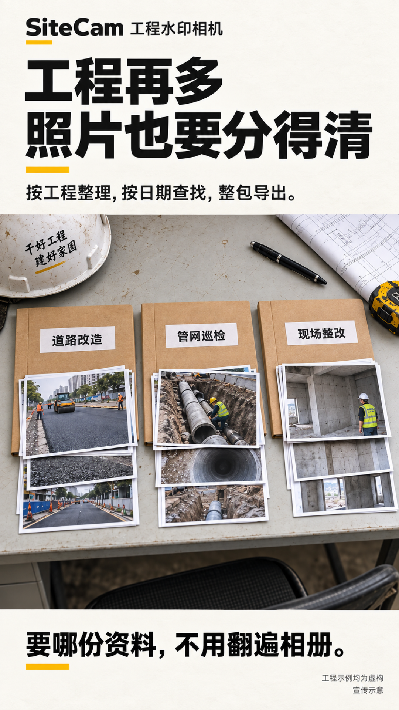
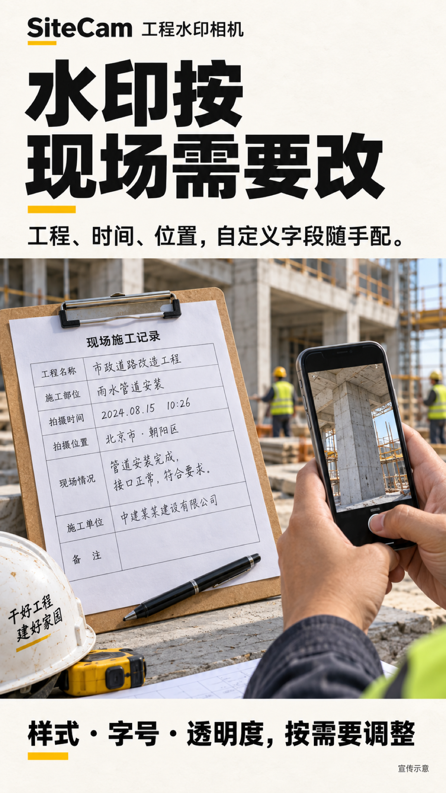
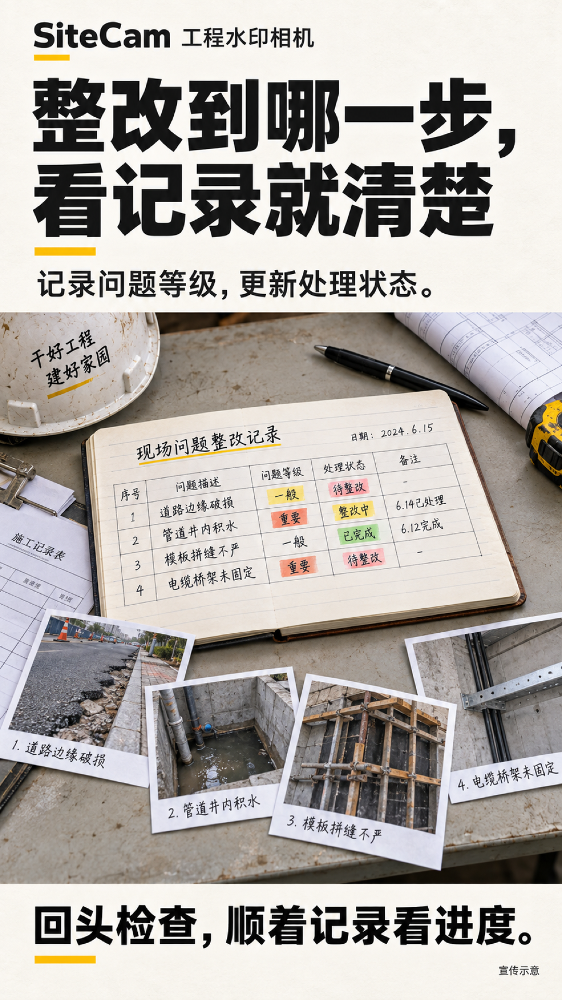
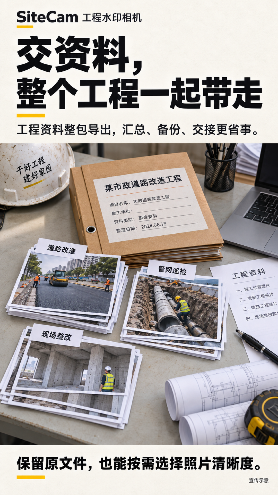

# SiteCam 工程水印相机

**拍好现场照片，整理好每个工程 · 免费 · 开源 · 无广告**

  <strong>简体中文</strong> &nbsp;|&nbsp; <a href="./README.en.md">English</a>

  
  
  
  
  

  <a href="https://github.com/toydream525/SiteCam/releases/download/v0.4.7/SiteCam-0.4.7-Android-Release.apk"><strong>⬇️ 下载安卓版 (推荐)</strong></a> &nbsp;·&nbsp;
  <a href="appmarket://details?id=com.sitecam.app">🌸 华为应用市场 (鸿蒙版)</a> &nbsp;·&nbsp;
  <a href="https://yuriaqua.com/sitecam/">🌐 项目官网</a> &nbsp;·&nbsp;
  <a href="./docs/USER_GUIDE.md">📖 使用说明</a> &nbsp;·&nbsp;
  <a href="https://github.com/toydream525/SiteCam/issues">💬 问题反馈</a>

---

## ✨ 界面与功能示意

工程现场的拍摄记录、水印定制、问题跟进与资料交付。当前公开版本为 **v0.4.7**，已优化折叠屏、阔直屏与平板适配（beta），并推出鸿蒙原生版。

<table>
  <tr>
    <td width="33%" align="center"></td>
    <td width="33%" align="center"></td>
    <td width="33%" align="center"></td>
  </tr>
  <tr>
    <td width="33%" align="center"></td>
    <td width="33%" align="center"></td>
    <td width="33%" align="center"></td>
  </tr>
</table>

---

## 🧰 核心功能

| 现场工作 | 用 SiteCam 怎么做 |
| :--- | :--- |
| **📷 拍施工照片** | 自动加上工程名称、时间、地点等水印，支持拍照与录像 |
| **⚡ 连续记录现场** | 支持抓拍与连拍，抓拍模式默认开启 |
| **🗂️ 整理不同项目** | 按工程保存，支持搜索、分类、归档；编辑与导出入口直接可见 |
| **📍 补充现场信息** | 地址不可用时可手动填写；海拔水印默认关闭，有效读数才会显示 |
| **🌦️ 天气与工程名称** | 支持快捷输入工程名称与编辑天气水印 |
| **🔒 安全切换工程** | 可查看、锁定或归档工程；锁定和归档工程不能拍摄，拍摄期间不切换工程 |
| **📱 多形态设备适配** | 优化安卓及鸿蒙的各类折叠屏、阔直屏和平板适配（beta），保留普通直屏与阔直屏布局 |
| **📅 快速找回照片** | 按日期、工程和问题状态筛选，支持批量移动与分享 |
| **🚩 记录现场问题** | 写下问题、标注轻重程度，持续跟进直至整改完成 |
| **✏️ 照片标注说明** | 裁剪、旋转、画箭头、写文字、打马赛克；文字标注支持拖动和再次编辑 |
| **🖼️ 已有照片补水印** | 导入本地照片，预览工程水印并另存新照片，完整保留原图 |
| **📦 交付工程资料** | 导出压缩包或文件夹，自带照片、视频与资料清单 |

---

## 🚀 三步快速上手

1. **建工程** — 填写工程名称，需要时补充线路与地点。
2. **拍照片** — 选择水印样式，把现场发现的问题随手记下来。
3. **交资料** — 在工程或相册里一键导出，按需分享给同事。

> 详细操作指南请见 [📖 使用说明](docs/USER_GUIDE.md)，也可在应用内「设置 → 使用技巧与教程」离线阅读。

---

## ⬇️ 下载与平台支持

| 设备平台 | 当前状态 | 获取方式 |
| :--- | :--- | :--- |
| **🤖 Android 手机 / 平板** | **v0.4.7 正式可用**（Android 8.0+） | [下载 Release APK](https://github.com/toydream525/SiteCam/releases/download/v0.4.7/SiteCam-0.4.7-Android-Release.apk) |
| **🌸 HarmonyOS 手机 / 平板** | **v0.4.7 原生版**（商店新版本以审核进度为准） | [华为应用市场直接下载](appmarket://details?id=com.sitecam.app) · [未签名 HAP](https://github.com/toydream525/SiteCam/releases/download/v0.4.7/SiteCam-0.4.7-HarmonyOS-Release-Unsigned.hap) · [签名说明](harmonyos/README.md) |
| **🍎 iPhone / iPad** | 开发中，暂无安装包 | — |

> [!NOTE]
> **鸿蒙版说明：** 鸿蒙原生版已上架华为应用市场，华为手机与平板用户可点击上方链接直接唤起应用市场，或在应用市场搜索“SiteCam工程水印相机”一键安装（无需自行签名）。侧载测试可使用公开的未签名 Release HAP，需自行签名后安装。鸿蒙版不申请应用联网权限；地址由系统服务提供（系统服务可能联网），断网时可手动填写地点。

---

## 🔒 数据存储与隐私

- 照片与记录默认保存在应用本地；**卸载前请先导出需要保留的工程资料**。
- **安卓版**：开启「同时在系统相册显示」后，两边共用同一份文件；系统相册删除后应用会同步隐藏，从回收站恢复后会重新显示。
- **鸿蒙版**：「另存到系统相册」会额外保存一份副本，两份互不影响。
- **无需注册账号**：定位与录音均为按需授权，拒绝定位仍可拍照，拒绝录音仍可录制无声视频。

---

## 🆕 最近更新（v0.4.7）

- 鸿蒙版支持通过系统分享转发工程压缩包。
- 统一安卓与鸿蒙端的工程压缩包命名规则。
- 修复同时保存的无水印图和水印图画幅不一致的问题。
- 安卓端新增自定义水印字段时支持同时填写名称与内容。

👉 [查看完整更新日志](CHANGELOG.md) · [反馈问题 / 提建议](https://github.com/toydream525/SiteCam/issues)

---

## 📜 开源许可与参与贡献

本项目由 [ninjaaqua](https://github.com/toydream525) 独立开发，采用 [**MIT 开源许可**](LICENSE)。 
欢迎参与贡献：[开发说明](docs/DEVELOPMENT.md) &nbsp;·&nbsp; [开发进度](PROGRESS.md) &nbsp;·&nbsp; [项目官网](https://yuriaqua.com/sitecam/)

